# Hengtu Forum Feature Guide

[中文](README.md) | **English** | [한국어](README.ko.md)

Hengtu Forum is for campus life and interest communities. Members browse posts, look for circles of people who share their interests, and publish a short note, a long article, an image post, or a video. They take part by liking, saving, commenting, tipping with points, and paying to read. Operators use it to follow the community, maintain users and content, review comments and interactions, and manage membership plans and top-up orders.

The product has a member app and an operations console. The member app is for phones. The console is for day-to-day operations.

## What it covers

**Member app**

- Posts: view, publish, like, save, comment, tip with points, paid reading
- Circles: public circles, private circles, create a circle, ask to join, join review, members and admins, block
- Messages: announcements, direct messages, comments, friend requests
- Profile: follows, membership, check in for points, member badges, reports

**Operations console**

- Statistics, users, topics, posts, comments, interaction notices, membership, top-up orders
- Daily work also covers join review, reports, sensitive words, chat logs, withdrawals, payment bills, plus disabling an account, muting a user, publishing or unpublishing a post, and the system theme

## Member app

<table>
<tr>
<td align="center" width="33%">
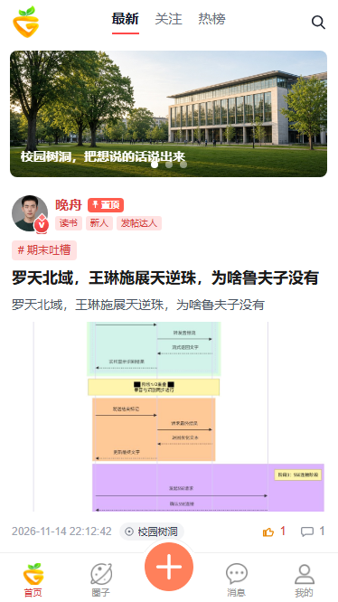 Home feed
</td>
<td align="center" width="33%">
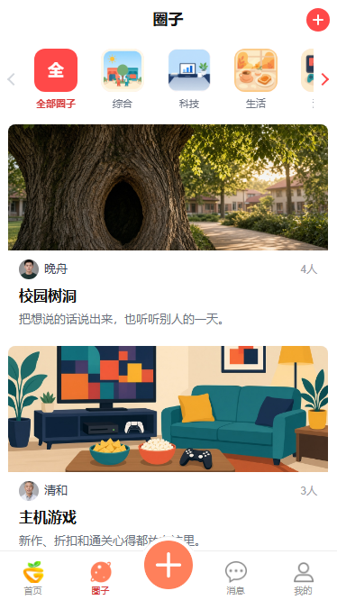 Public circles
</td>
<td align="center" width="33%">
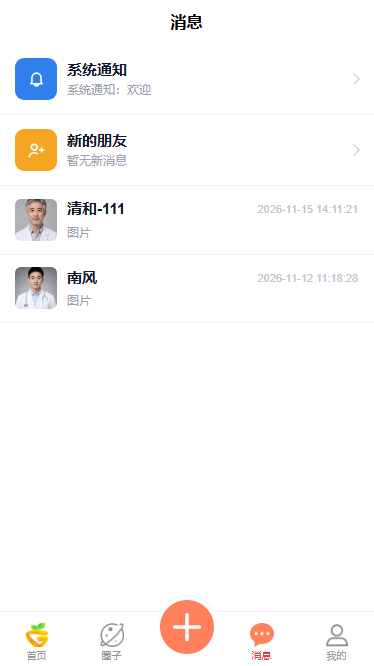 Announcements, friends, and messages
</td>
</tr>
<tr>
<td align="center" colspan="3">
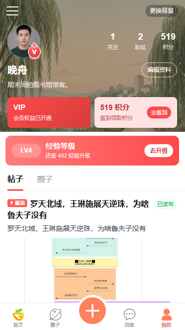 Membership, check-in, and level
</td>
</tr>
</table>

### Posts

- **Text**: Share an opinion, something you saw, or a notice. A title and a body are enough. It fits a short comment or an everyday note. The feed shows the author, topic, summary, circle, and the like and comment counts.
- **Article**: Write one thing all the way through. The body can be split into sections, with headings and lists, and it opens as an article.
- **Image post**: Add images to the text. It fits an event note, a route share, or an on-site explanation. Images follow the body, so the reader sees the words and the pictures together.
- **Video**: Record a process. The video sits above the rest. Below it are the author, title, body, topic, and circle, plus the view count.
- **Like, save, and comment**: A like means agreement. A save keeps the post to read later. A comment adds a detail, a question, or a sign-up. A reply to someone else becomes a nested thread.
- **Point tips**: A reader thanks the author with points. The tip is sent to the author as a notice, as a way to support a post worth reading.
- **Paid posts**: The full post opens only to a reader who has paid. Before payment, only the summary is visible. After payment, the body, images, or video open.

The home feed shows the author, topic, title, summary, images, circle, likes, and comments in one place. It is meant for everyday browsing of text and image posts.

A video post leads with the picture and the body. A long image post unfolds several paragraphs and images. At the end, a reader can tip with points, and read or reply to comments.

  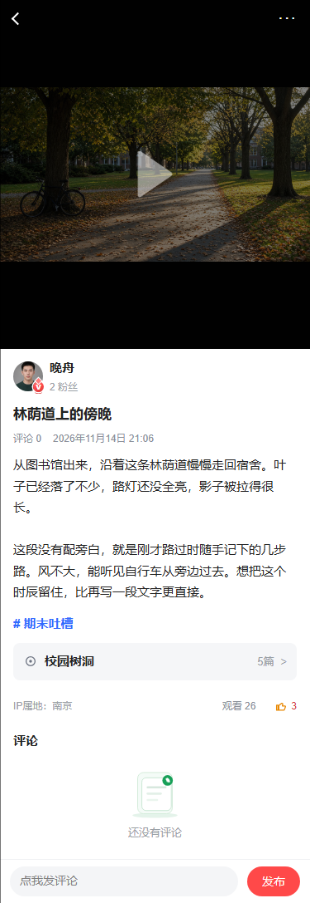
  &nbsp;&nbsp;
  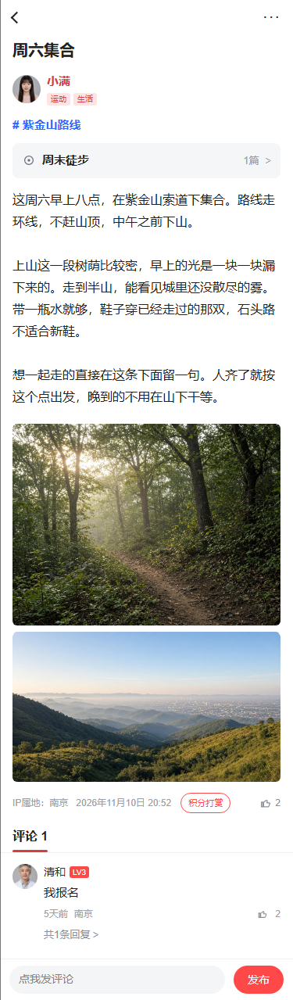

Video post · Image post, comments, and point tips

### Circles

- **Public circles**: Open to the whole community. Members can see the cover, intro, owner, member count, and the posts inside. They fit shared interests and public topics. Circles are grouped by category, such as general, technology, and life.
- **Private circles**: Posts inside are open only to members who have joined. They fit a small group or a closed discussion. Anyone who has not joined cannot read what is inside.

The list is grouped by category. Each card shows the cover, owner, member count, name, and intro. Inside a circle, the cover, intro, owner, and posts sit together, and members read and publish around one subject. The owner and admins handle join requests, manage members and admins, and can block or unblock someone.

  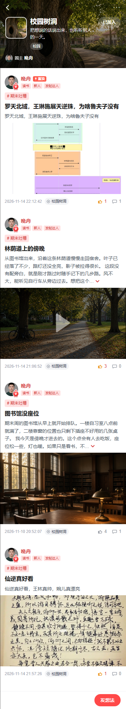

Posts inside a circle

### Messages

- **Announcements**: Platform notices, such as a welcome or community news, so an important notice is not lost among posts.
- **Direct messages**: A conversation with one person. Each thread keeps the other person, the latest message, and the time. A message can be text or an image.
- **Comments**: Comments and replies under a post become the discussion. The author can also see who commented, then return to the original post.
- **Friend requests**: Handle a new friend request. Once it is accepted, the two people are connected and can keep messaging.

The top of the messages page shows announcements and new friends. Below are direct-message threads.

### Profile

- **Membership**: Start or renew a membership. The profile shows whether it is active. Plans differ by the number of days and the price. An active plan includes its benefits.
- **Check in for points**: Collect points once a day. A longer streak earns more. The profile shows the current points and whether today is already checked in.
- **Member badge**: Shows identity and how much someone takes part. The avatar carries a member mark. The level shows the current rank and how much XP is left until the next one.
- **Reports**: Submit a note and image evidence about a post, a comment, a user, or a circle, then check the status and the reply from the platform.

The profile also shows follows, followers, points, membership, and level, together with the posts you have published.

## Operations console

### Statistics

Follow membership top-ups, the size of the user base, how many posts go up, and new users, and see the trend by week, month, and year.

  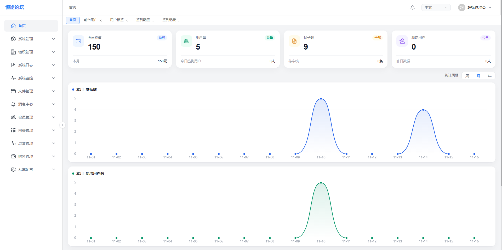

Statistics

### Users

Look up and maintain member profiles, account status, and whether someone is muted.

  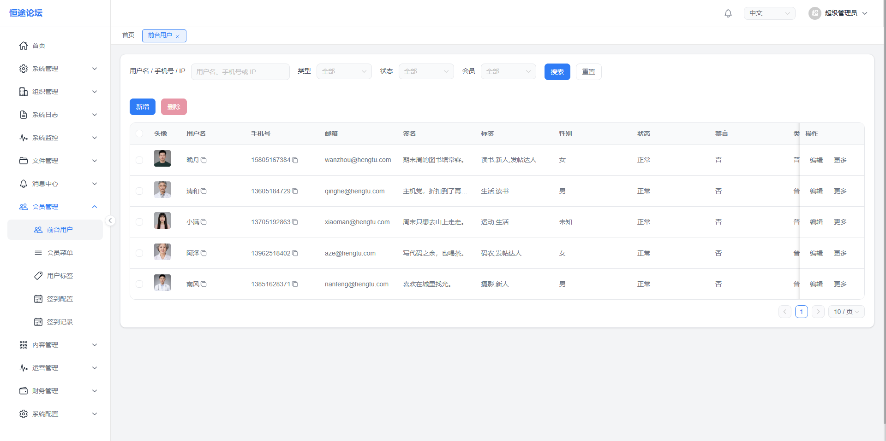

Users

### Topics

Maintain the topics under a circle, their view counts, and pinned content.

  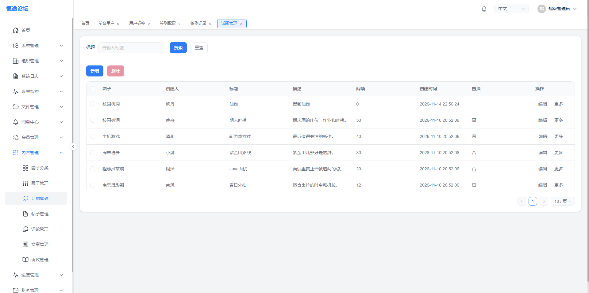

Topics

### Posts

Review image posts, videos, and polls on the site, and publish or unpublish them.

  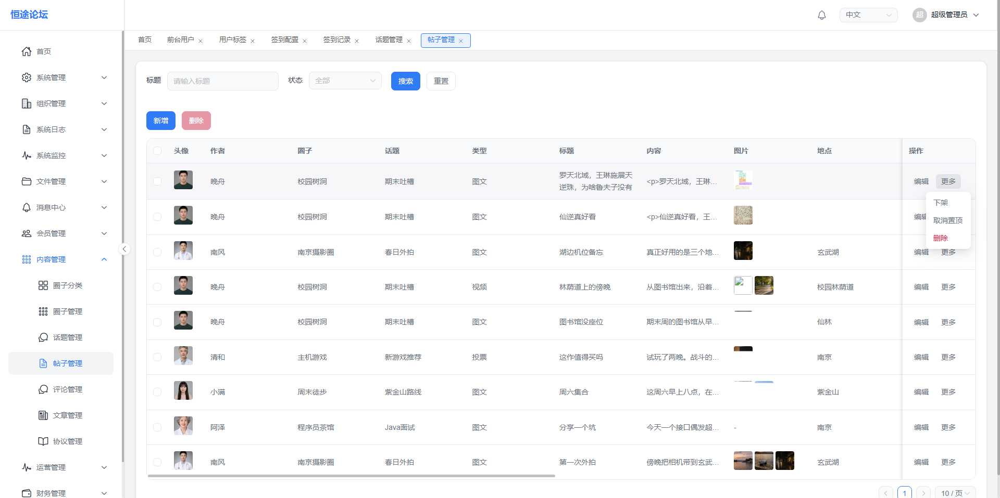

Posts

### Comments

Read comments and nested replies, and organize the discussion.

  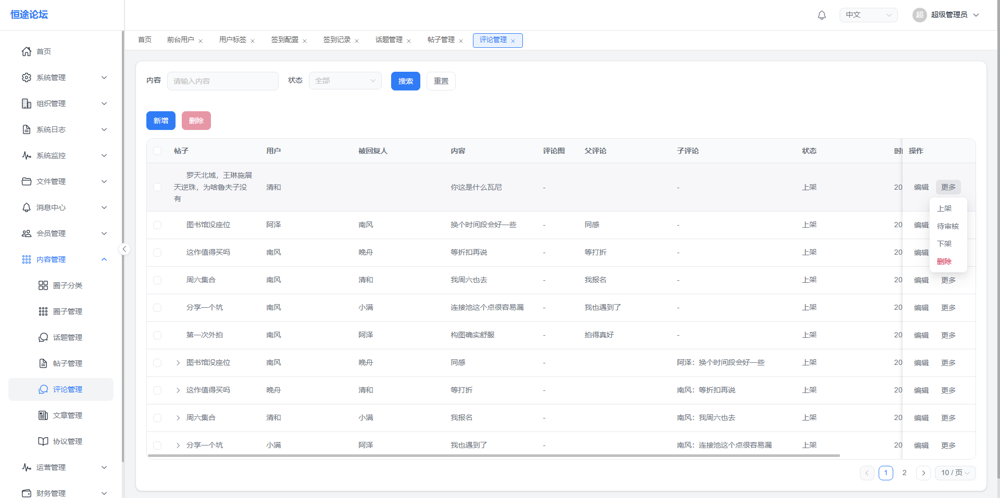

Comments

### Interaction notices

See whether a like, a comment, a follow, or a point tip has reached the right user.

  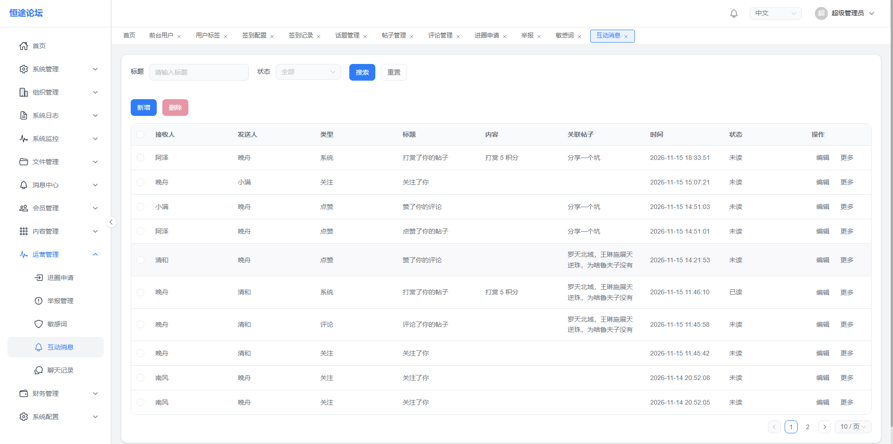

Interaction notices

### Membership plans

Set the length and price of the trial, monthly, quarterly, half-year, and yearly plans.

  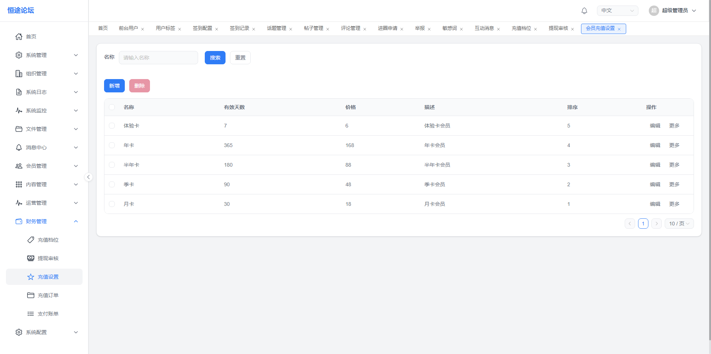

Membership plans

### Top-up orders

Check the amount, the bonus, and the payment result of a wallet top-up.

  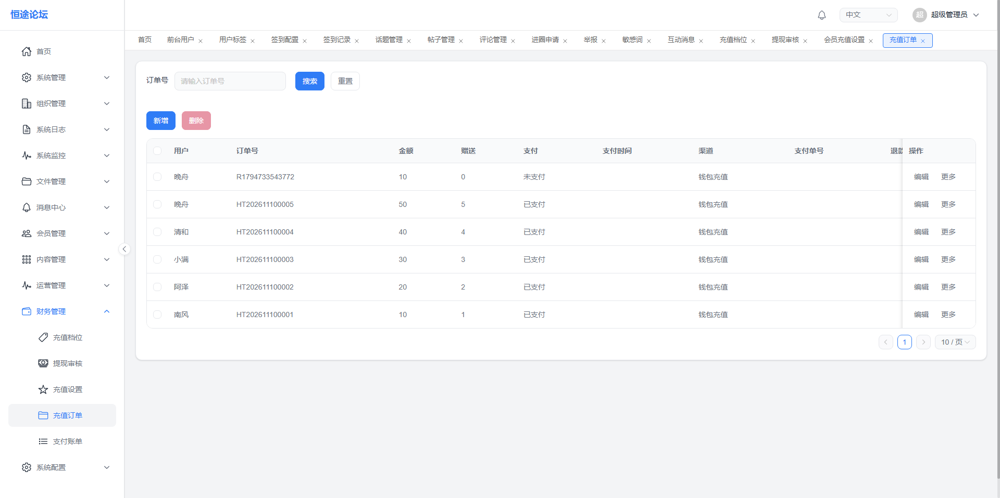

Top-up orders

### Daily operations

- **Join review**: Handle a request to join a circle that requires approval.
- **Reports**: Read a report from a member and send back a result.
- **Sensitive words**: Keep the words that should be blocked or sent for review when someone publishes.
- **Chat logs**: Read direct-message threads and deal with messages that break the rules.
- **Withdrawals and payment bills**: Check withdrawal requests and payment results.
- **System theme**: Choose the theme used on the member app.
