# 헝투 포럼 기능 안내

[中文](README.md) | [English](README.en.md) | **한국어**

헝투 포럼은 캠퍼스와 관심사 커뮤니티를 위한 서비스입니다. 회원은 글을 읽고 관심사가 비슷한 모임을 찾으며, 짧은 글, 장문, 이미지 글, 동영상을 올립니다. 좋아요, 저장, 댓글, 포인트 후원, 유료 열람으로 이야기에도 참여합니다. 운영자는 커뮤니티 현황을 보고, 사용자와 콘텐츠를 관리하고, 댓글과 상호작용을 확인하며, 회원 요금제와 충전 주문을 다룹니다.

서비스는 회원용과 운영 관리용으로 나뉩니다. 회원용은 휴대폰에서 쓰고, 관리용은 매일의 운영에 씁니다.

## 전체 기능

**회원**

- 게시글: 보기, 작성, 좋아요, 저장, 댓글, 포인트 후원, 유료 열람
- 모임: 공개 모임, 비공개 모임, 모임 만들기, 가입 신청, 가입 심사, 멤버와 관리자, 차단
- 메시지: 공지, 쪽지, 댓글, 친구 신청
- 내 정보: 팔로우, 회원 충전, 출석 포인트, 회원 배지, 신고

**운영 관리**

- 통계, 사용자, 주제, 게시글, 댓글, 상호작용 알림, 회원 충전, 충전 주문
- 매일의 운영에는 가입 심사, 신고 처리, 금칙어, 채팅 기록, 출금, 결제 내역이 있고, 계정 사용 중지, 발언 제한, 게시글 올리기와 내리기, 시스템 테마 설정도 포함됩니다.

## 회원

<table>
<tr>
<td align="center" width="33%">
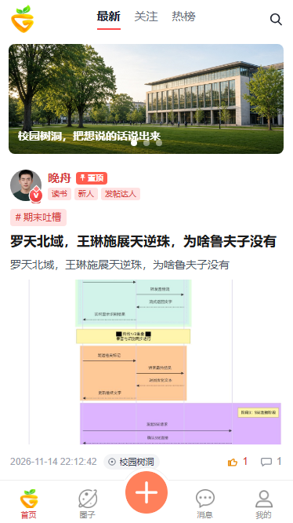 홈 피드
</td>
<td align="center" width="33%">
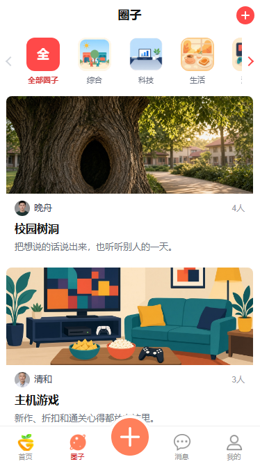 공개 모임
</td>
<td align="center" width="33%">
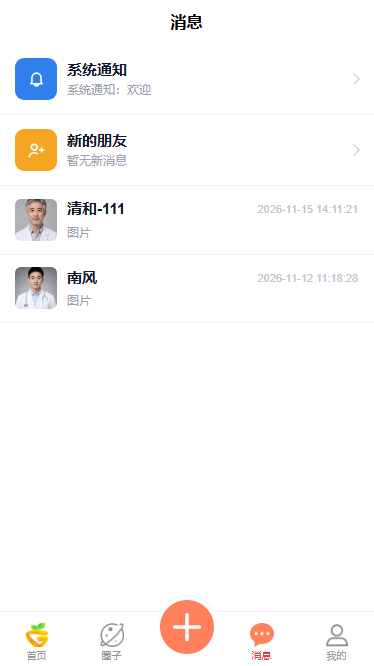 공지, 친구, 쪽지
</td>
</tr>
<tr>
<td align="center" colspan="3">
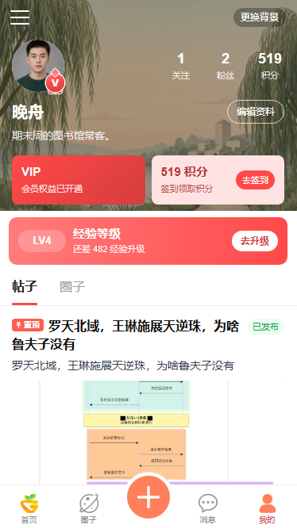 회원, 출석, 등급
</td>
</tr>
</table>

### 게시글

- **짧은 글**: 의견, 소식, 알림을 남깁니다. 제목과 본문이면 충분하고, 짧은 의견과 일상 기록에 맞습니다. 피드에서는 작성자, 주제, 요약, 소속 모임, 좋아요와 댓글 수를 볼 수 있습니다.
- **장문**: 한 가지 일을 끝까지 씁니다. 본문을 나누고 소제목과 목록을 넣을 수 있으며, 읽을 때는 글 형태로 펼쳐집니다.
- **이미지 글**: 글 옆에 이미지를 붙입니다. 행사 기록, 동선 공유, 현장 설명에 맞습니다. 이미지는 본문 뒤에 와서, 글과 화면을 함께 봅니다.
- **동영상**: 한 과정을 기록합니다. 영상은 내용 위에 있고, 아래에는 작성자, 제목, 본문, 주제, 모임, 조회 수가 있습니다.
- **좋아요, 저장, 댓글**: 좋아요는 동의입니다. 저장은 글을 자기 목록에 남겨 나중에 다시 봅니다. 댓글은 보충, 질문, 신청에 씁니다. 다른 댓글에 답하면 대댓글이 됩니다.
- **포인트 후원**: 읽는 사람이 포인트로 작성자에게 감사를 전합니다. 후원 포인트는 작성자에게 알림으로 가며, 좋은 글을 응원하는 방법입니다.
- **유료 글**: 결제한 사람에게만 전문이 열립니다. 결제 전에는 소개만 보이고, 결제 후에 본문, 이미지, 동영상을 볼 수 있습니다.

홈 피드는 작성자, 주제, 제목, 요약, 이미지, 모임, 좋아요, 댓글을 한곳에 보여 줍니다. 글과 이미지 글을 매일 둘러보기에 맞습니다.

동영상 글은 화면과 본문을 앞에 둡니다. 긴 이미지 글은 여러 단락과 이미지를 펼칩니다. 글 끝에서 포인트로 후원할 수 있고, 댓글을 보고 답할 수 있습니다.

  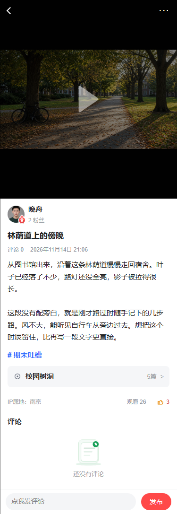
  &nbsp;&nbsp;
  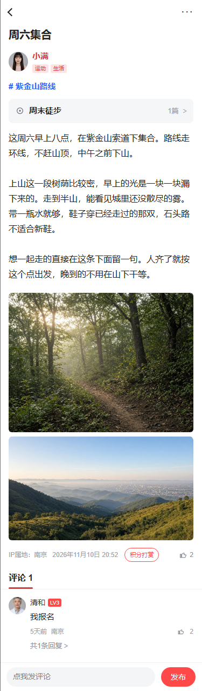

동영상 글 · 이미지 글, 댓글, 포인트 후원

### 모임

- **공개 모임**: 커뮤니티 전체에 열려 있습니다. 멤버는 표지, 소개, 모임장, 인원, 모임 안 글을 볼 수 있습니다. 관심사 교류와 공개 주제에 맞습니다. 모임은 종합, 기술, 생활 같은 분류로 모입니다.
- **비공개 모임**: 가입한 멤버에게만 모임 안 글이 열립니다. 내부 소그룹이나 범위를 한정한 토론에 맞습니다. 가입하지 않으면 안의 내용을 볼 수 없습니다.

목록은 분류별로 나옵니다. 카드마다 표지, 모임장, 멤버 수, 이름, 소개가 있습니다. 모임에 들어가면 표지, 소개, 모임장, 글이 한곳에 모이고, 멤버는 같은 주제로 읽고 글을 올립니다. 모임장과 관리자는 가입 신청을 처리하고, 멤버와 관리자를 관리하며, 차단하거나 차단을 풀 수 있습니다.

  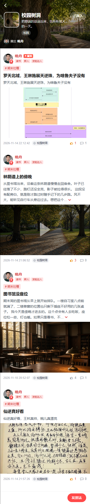

모임 안의 글

### 메시지

- **공지**: 환영 인사, 커뮤니티 소식 같은 플랫폼 알림을 받습니다. 중요한 알림이 글 사이에 흩어지지 않게 합니다.
- **쪽지**: 한 사용자와 따로 이야기합니다. 대화에는 상대, 최근 내용, 시간이 남습니다. 내용은 글이거나 이미지입니다.
- **댓글**: 글 아래의 댓글과 답이 토론이 됩니다. 작성자는 누가 자기 글에 댓글을 달았는지 알고, 원래 글로 돌아가 이어 갈 수 있습니다.
- **친구 신청**: 새 친구 요청을 처리합니다. 수락하면 서로 이어지고, 쪽지를 계속할 수 있습니다.

메시지 화면 위쪽은 공지와 새 친구이고, 아래쪽은 쪽지 대화입니다.

### 내 정보

- **회원 충전**: 회원을 열거나 이어 갑니다. 내 정보에는 회원이 열려 있는지가 표시됩니다. 요금제는 유효 일수와 가격으로 나뉘고, 열면 그에 해당하는 혜택을 받습니다.
- **출석하고 포인트 받기**: 하루에 한 번 포인트를 받습니다. 연속으로 출석하면 보상이 늘어납니다. 내 정보에는 현재 포인트와 오늘 출석했는지가 바로 나옵니다.
- **회원 배지**: 누구인지, 얼마나 참여했는지를 보여 줍니다. 프로필에는 회원 표시가 붙습니다. 경험 등급은 현재 단계와 다음 단계까지 남은 경험치를 보여 줍니다.
- **신고**: 게시글, 댓글, 사용자, 모임에 대해 설명과 이미지 증거를 보낸 뒤, 처리 상태와 플랫폼의 회신을 확인합니다.

내 정보에는 팔로잉, 팔로워, 포인트, 회원 상태, 경험 등급과 내가 올린 글이 함께 있습니다.

## 운영 관리

### 통계

회원 충전, 사용자 규모, 올린 글 수, 신규 사용자를 보고, 주·월·년 단위로 변화를 확인합니다.

  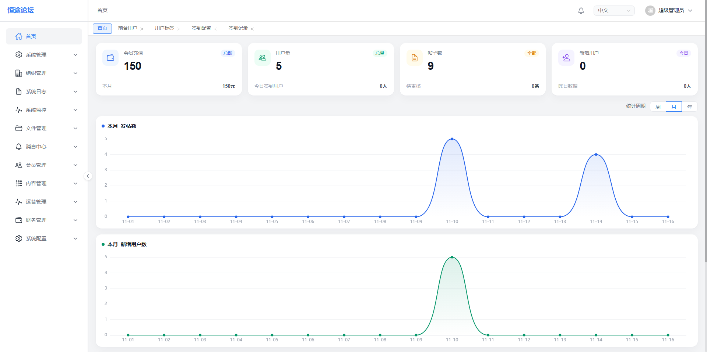

통계

### 사용자

회원 정보, 계정 상태, 발언 제한 여부를 조회하고 관리합니다.

  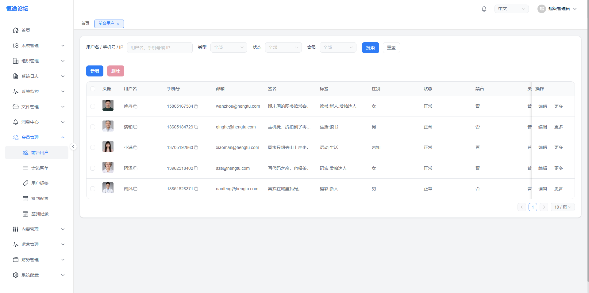

사용자

### 주제 관리

모임 아래의 주제, 조회 수, 고정된 콘텐츠를 관리합니다.

  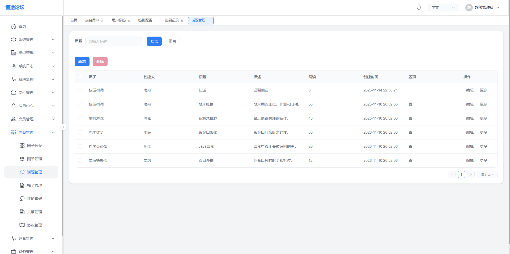

주제 관리

### 게시글 관리

사이트의 이미지 글, 동영상, 투표를 보고 정리하고, 글을 올리거나 내립니다.

  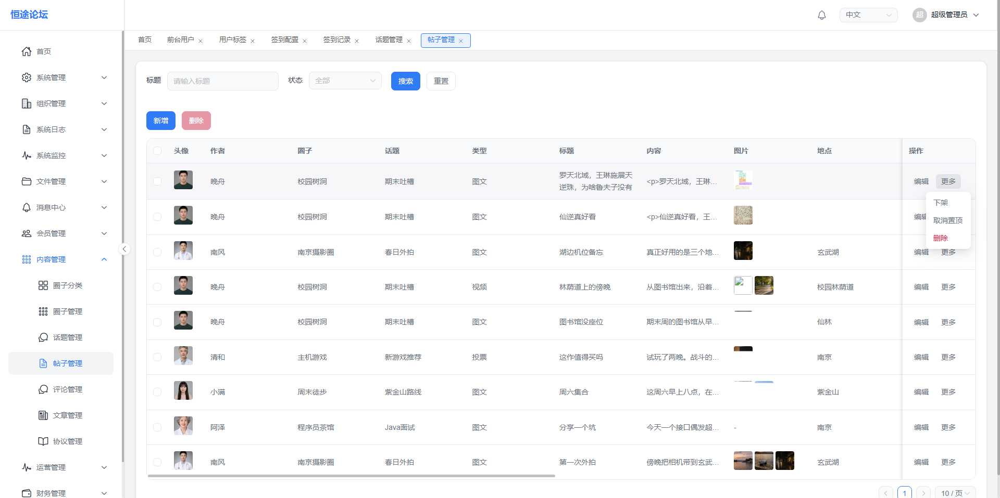

게시글 관리

### 댓글 관리

댓글과 대댓글을 보고 토론 내용을 정리합니다.

  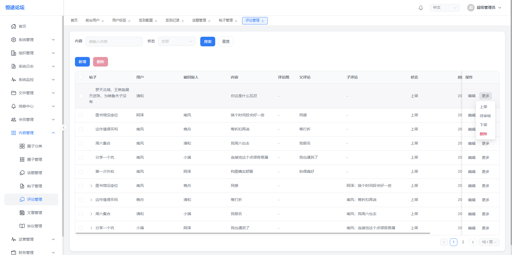

댓글 관리

### 상호작용 알림

좋아요, 댓글, 팔로우, 포인트 후원이 해당 사용자에게 전달됐는지 확인합니다.

  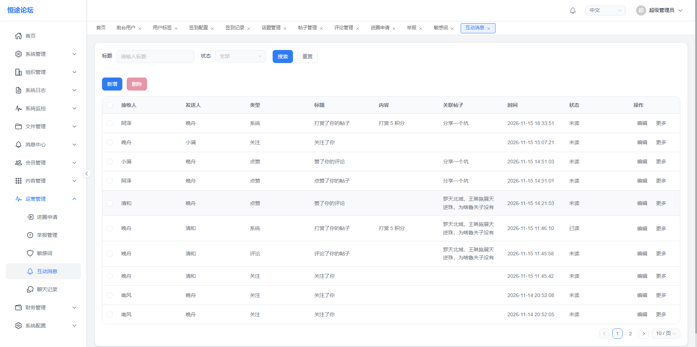

상호작용 알림

### 회원 요금제

체험권, 월간권, 분기권, 반년권, 연간권의 유효 일수와 가격을 설정합니다.

  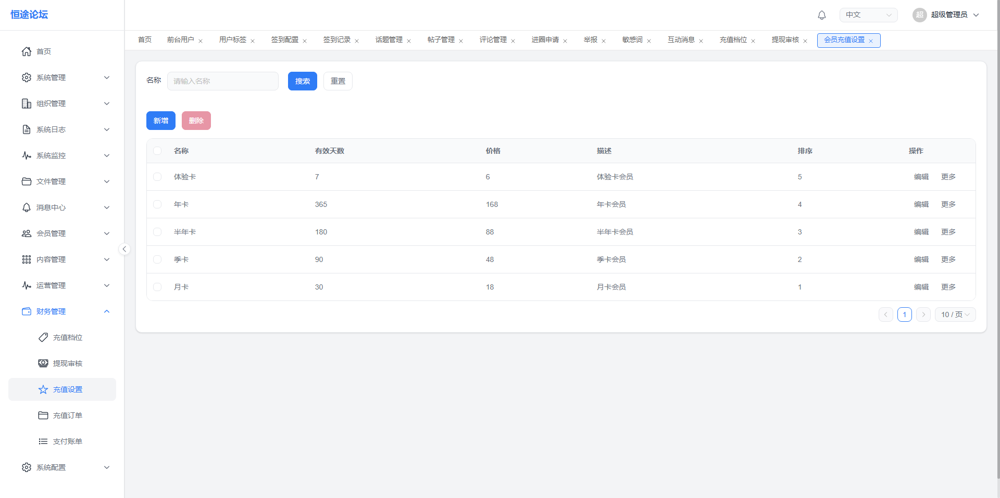

회원 요금제

### 충전 주문

지갑 충전의 금액, 보너스, 결제 결과를 대조합니다.

  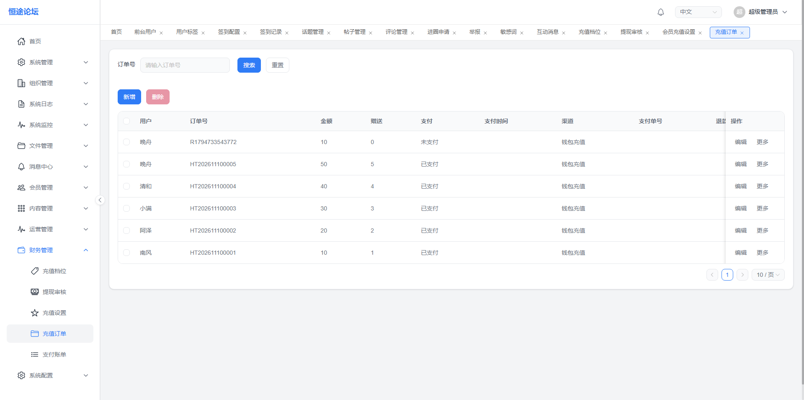

충전 주문

### 일상 운영

- **가입 심사**: 심사를 거쳐야 들어갈 수 있는 모임 신청을 처리합니다.
- **신고 처리**: 회원이 보낸 신고를 보고 처리 결과를 남깁니다.
- **금칙어**: 글을 올릴 때 막거나 심사로 보낼 단어를 관리합니다.
- **채팅 기록**: 쪽지 대화를 보고, 규정에 어긋난 메시지를 처리합니다.
- **출금과 결제 내역**: 출금 신청과 결제 결과를 확인합니다.
- **시스템 테마**: 회원 화면에 사용할 테마를 설정합니다.
