# 恒途论坛功能文档

**中文** | [English](README.en.md) | [한국어](README.ko.md)

恒途论坛用于校园和兴趣社区。成员用它看内容、找同好圈子，发布文字、长文、图文或视频，并通过点赞、收藏、评论、积分打赏和付费阅读参与讨论。运营人员用它掌握社区情况，维护用户和内容，查看评论与互动，并管理会员方案和充值订单。

系统分为会员端和运营管理端。会员端面向手机使用，管理端面向日常运营。

## 整体功能

**会员端**

- 帖子：查看、发布、点赞、收藏、评论、积分打赏、付费阅读
- 圈子：公开圈子、私密圈子、创建圈子、申请加入、进圈审核、成员与管理员、拉黑
- 互动消息：系统公告、私信、评论、好友申请
- 个人中心：用户关注、会员充值、签到领取积分、会员勋章、举报反馈

**运营管理端**

- 数据统计、前台用户、话题、帖子、评论、互动消息、会员充值、充值订单
- 日常运营还包括进圈审核、举报处理、敏感词、聊天记录、提现、支付账单，以及账号禁用、禁言、帖子上下架和系统主题设置

## 会员端

<table>
<tr>
<td align="center" width="33%">
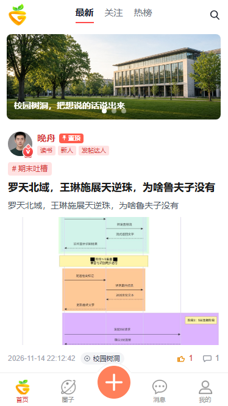 首页信息流
</td>
<td align="center" width="33%">
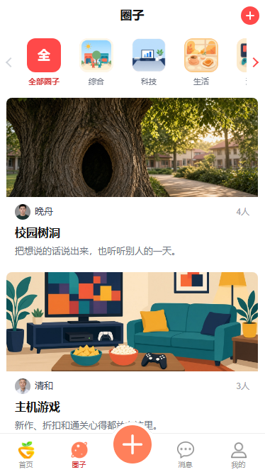 公开圈子
</td>
<td align="center" width="33%">
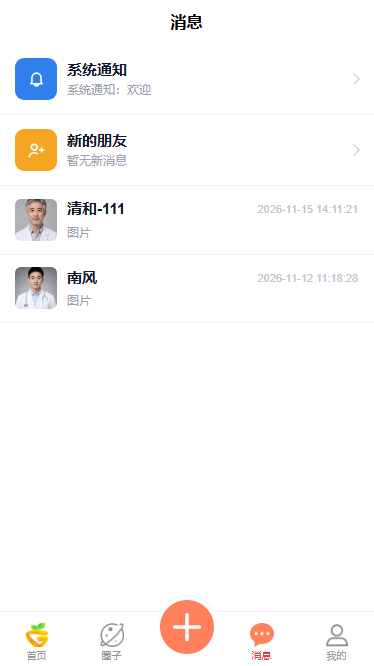 系统通知、好友与私信
</td>
</tr>
<tr>
<td align="center" colspan="3">
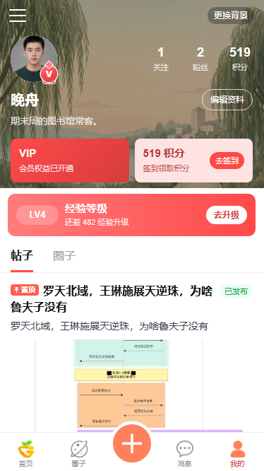 会员、积分签到与等级
</td>
</tr>
</table>

### 帖子

- **文字**：发表一条看法、见闻或通知。有标题和正文即可，适合短评和日常记录。信息流中能看到作者、话题、摘要、所属圈子，以及点赞和评论数量。
- **长文**：把一件事写完整。正文可以分段，并使用小标题和列表，阅读时按文章展开。
- **图文**：在文字之外配上图片，适合活动记录、路线分享和现场说明。图片跟在正文后面，读者同时看文字和画面。
- **视频**：记录一段过程。画面在内容上方，下面是作者、标题、正文、话题和圈子，并显示观看数量。
- **点赞、收藏、评论**：点赞表示认同，收藏把帖子留到自己的内容里以后再看，评论用来补充、提问或报名。评论可以回复他人，形成楼中楼。
- **积分打赏**：读者用积分感谢作者。打出的积分会通知到作者，适合对优质内容表示支持。
- **付费帖**：只对付款读者开放全文。未支付时只能看到简介，支付后查看正文、图片或视频。

首页信息流同时呈现作者、话题、标题、摘要、配图、圈子、点赞和评论，适合日常浏览文字和图文内容。

视频帖突出画面和正文。图文长帖展开多段文字和配图，文末可以积分打赏，并查看、回复评论。

  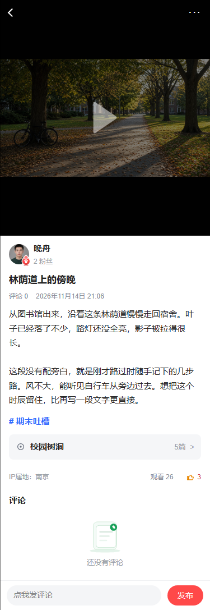
  &nbsp;&nbsp;
  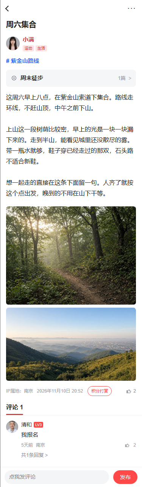

视频帖 · 图文帖、评论与积分打赏

### 圈子

- **公开圈子**：面向整个社区。成员可以看到封面、简介、圈主、人数和圈内帖子，适合兴趣交流和公开话题。圈子按综合、科技、生活等分类归集。
- **私密圈子**：只对已加入的成员开放圈内帖子，适合内部小组或限定范围的讨论。未加入时不能浏览圈内内容。

圈子列表按分类展示，每张卡片包含封面、圈主、成员数、名称和简介。进入圈子后，封面、简介、圈主和圈内帖子集中在一起，成员围绕同一主题阅读和发布。圈主和管理员可以处理加入申请、管理成员和管理员，并拉黑或解除拉黑。

  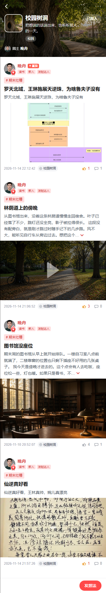

圈子内的帖子

### 互动消息

- **系统公告**：接收平台通知，例如欢迎语和社区消息，避免重要通知散落在帖子里。
- **私信**：和某一个用户单独交流。会话保留对方、最近一条内容和时间，内容可以是文字或图片。
- **评论**：帖子下的评论和回复会形成讨论。作者也能从互动里知道谁评论了自己的内容，再回到原帖继续交流。
- **好友申请**：处理新的朋友请求。通过后双方建立联系，可以继续私信。

消息页上方是系统通知和新的朋友，下方是私信会话。

### 个人中心

- **会员充值**：开通或延续会员。个人页显示会员是否已开通。会员方案按有效天数和价格区分，开通后享有对应权益。
- **签到领取积分**：按天领取积分，连续签到奖励更多。个人页直接显示当前积分，以及当天是否已经签到。
- **会员勋章**：体现身份和参与程度。头像带会员标识，经验等级显示当前级别，以及距离下一级还差多少经验。
- **举报反馈**：对帖子、评论、用户或圈子提交说明和图片证据，之后查看处理状态和平台反馈。

个人中心同时展示关注、粉丝、积分、会员状态和经验等级，以及自己已发布的帖子。

## 运营管理端

### 数据统计

掌握会员充值、用户规模、发帖量和新增用户，并按周、月、年看变化趋势。

  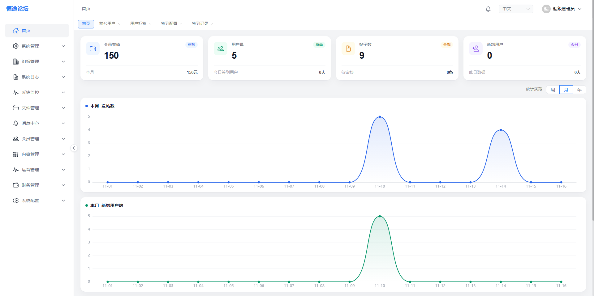

数据统计

### 前台用户

查询和维护会员资料、账号状态和禁言情况。

  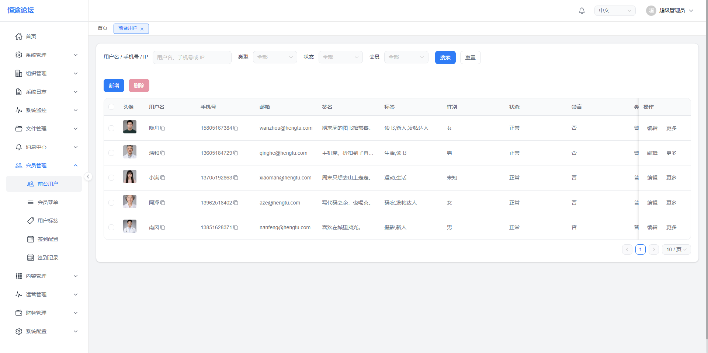

前台用户

### 话题管理

维护圈子下的话题、阅读量和置顶内容。

  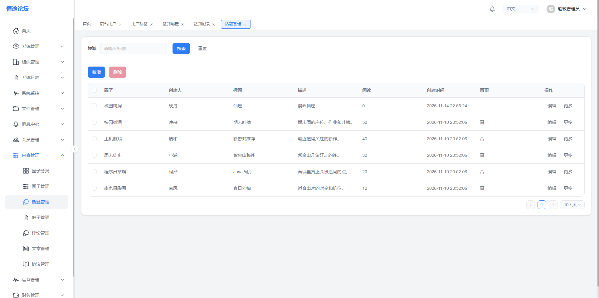

话题管理

### 帖子管理

查看和整理站内图文、视频和投票内容，处理帖子上下架。

  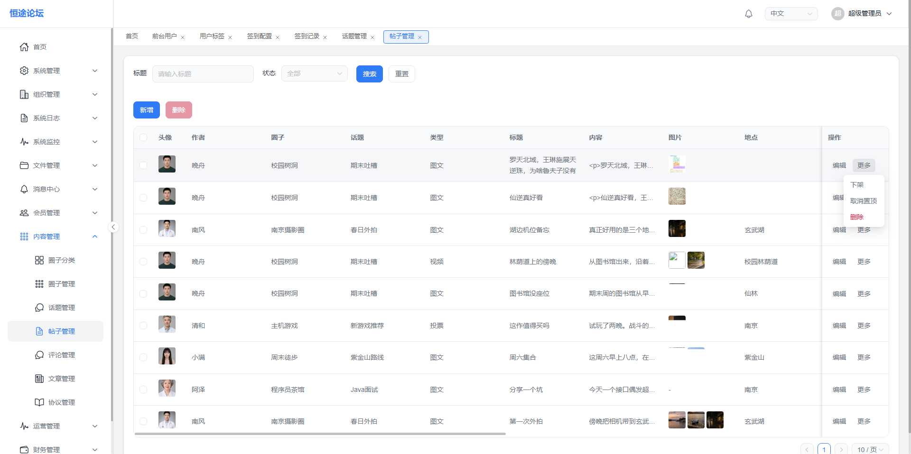

帖子管理

### 评论管理

查看评论和楼中楼回复，整理讨论内容。

  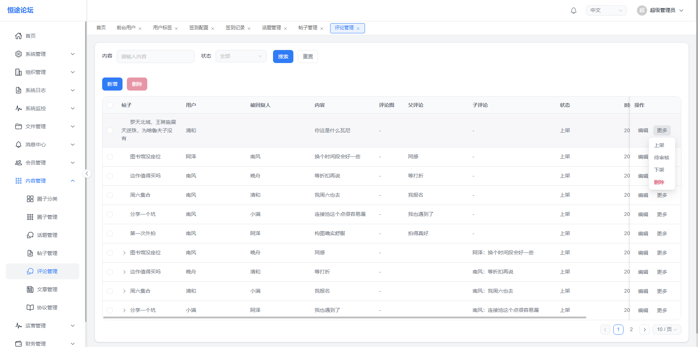

评论管理

### 互动消息

查看点赞、评论、关注和积分打赏是否已经通知到对应用户。

  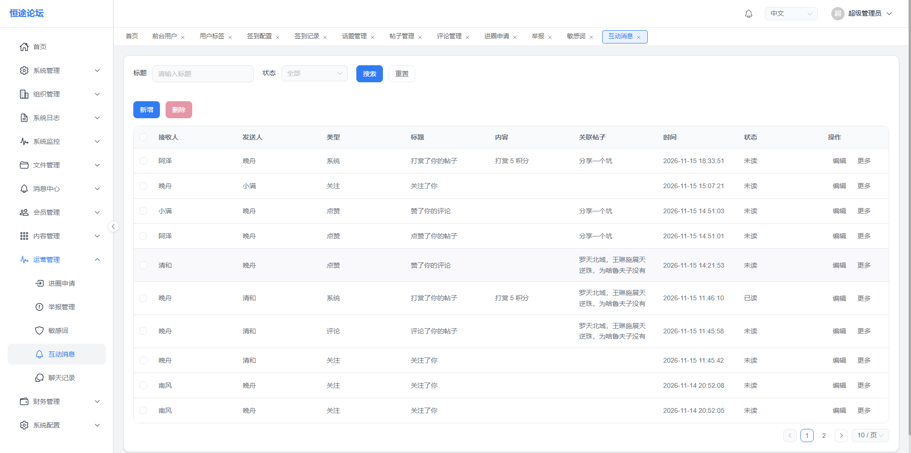

互动消息

### 会员充值设置

配置体验卡、月卡、季卡、半年卡和年卡的有效天数与价格。

  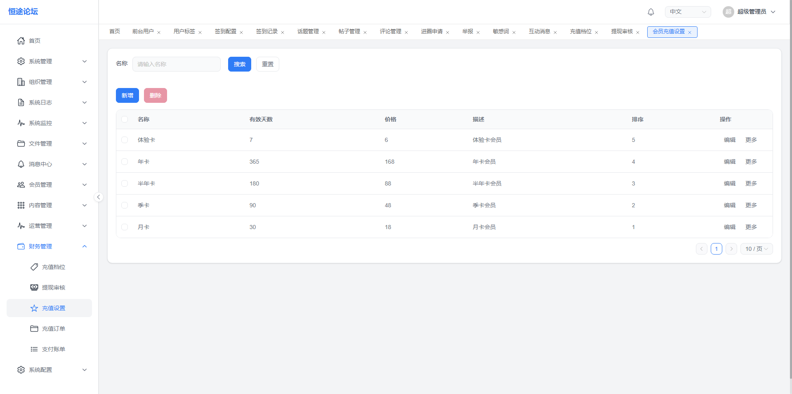

会员充值设置

### 充值订单

核对钱包充值的金额、赠送和支付结果。

  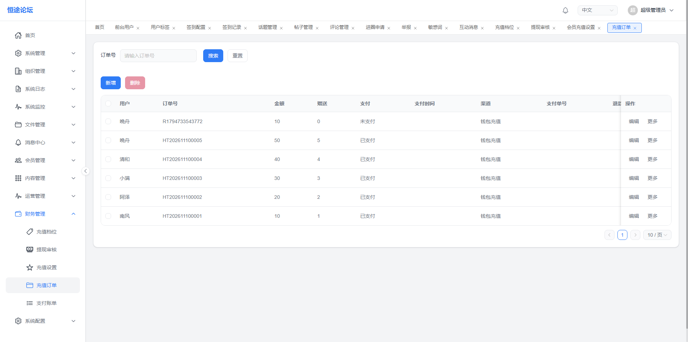

充值订单

### 日常运营

- **进圈审核**：处理需要审核才能加入的圈子申请。
- **举报处理**：查看成员提交的举报，并给出处理反馈。
- **敏感词**：维护发布时需要拦截或审核的词语。
- **聊天记录**：查看私信会话，处理违规消息。
- **提现与支付账单**：核对提现申请和支付结果。
- **系统主题**：设置前台展示使用的主题。
